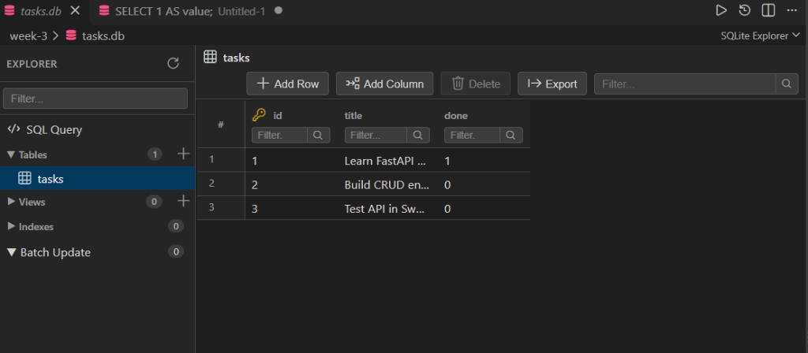

# Week 3 — Task CRUD API with SQLite (FastAPI)

A persistent To-Do list REST API built with **FastAPI** and Python's built-in **`sqlite3`** library. It preserves the exact same CRUD endpoints and HTTP status codes from Week 2 while replacing the in-memory list with a real SQLite database so tasks survive server restarts.

## Why SQLite?

- **Zero setup:** SQLite is built directly into Python's standard library (`sqlite3`) and requires no separate database server or background daemon.
- **Single-file persistence:** All tables and rows live in one portable file on disk, making it ideal for local development and small services while still using real SQL (`SELECT`, `INSERT`, `UPDATE`, `DELETE`).
- **Clean separation of layers:** The API routes and JSON contracts stay identical to Week 2—only the data storage layer changed.

## Database File Location

- **File path:** `week-3/tasks.db` (resolved relative to `main.py` via `Path(__file__).with_name("tasks.db")`).
- **Auto-initialization:** On startup, if `tasks.db` or the `tasks` table does not exist, the app creates them automatically and seeds 3 example tasks only when the table is empty (`COUNT(*) == 0`).
- **Git ignored:** `*.db` is listed in the root `.gitignore` so every fresh clone creates its own clean `tasks.db` on first run.

## How to Start the Project

From the `week-3` directory, install dependencies and start the server:

```bash
pip install -r requirements.txt && python -m uvicorn main:app --reload
```

Once running, open:
- **API Root:** <http://127.0.0.1:8000/>
- **Swagger UI:** <http://127.0.0.1:8000/docs>

## Endpoints

| Method | Path | Description | Status Codes |
| :--- | :--- | :--- | :--- |
| `GET` | `/` | API metadata (`name`, `version`, `endpoints`) | `200` |
| `GET` | `/health` | Health check (`{"status": "ok"}`) | `200` |
| `GET` | `/tasks` | List all tasks from `tasks.db` | `200` |
| `GET` | `/tasks/{task_id}` | Get a single task by ID | `200`, `404` |
| `POST` | `/tasks` | Insert a new task (`{"title": "..."}`) | `201`, `400` |
| `PUT` | `/tasks/{task_id}` | Update a task's `title` and/or `done` flag | `200`, `400`, `404` |
| `DELETE` | `/tasks/{task_id}` | Delete a task by ID | `204`, `404` |

## Example SQL Query Executed

All five Stage 4 queries are saved in [`queries.sql`](queries.sql). Example query executed directly against `tasks.db`:

```sql
SELECT * FROM tasks WHERE done = 1;
```

Observed result on the seeded database:

```text
[(1, 'Learn FastAPI basics', 1)]
```

## Database Viewer Screenshot

Viewing `week-3/tasks.db` in SQLite Explorer:


